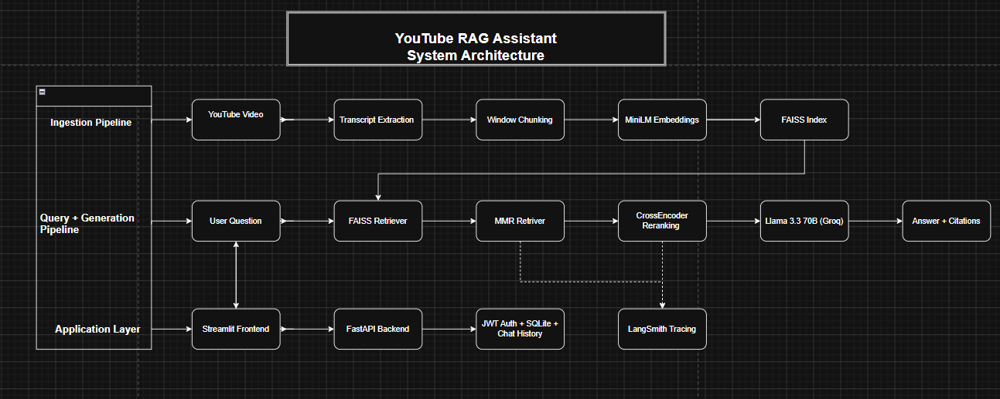
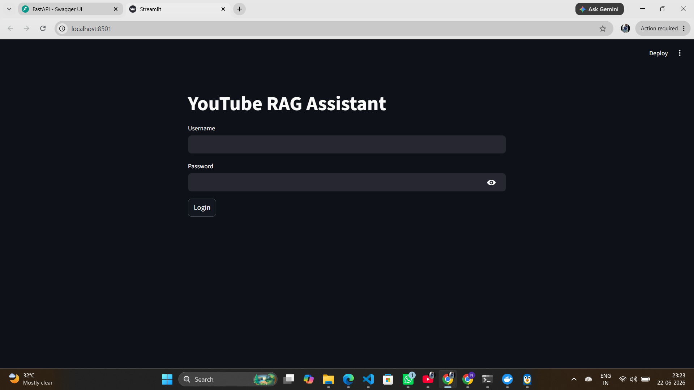
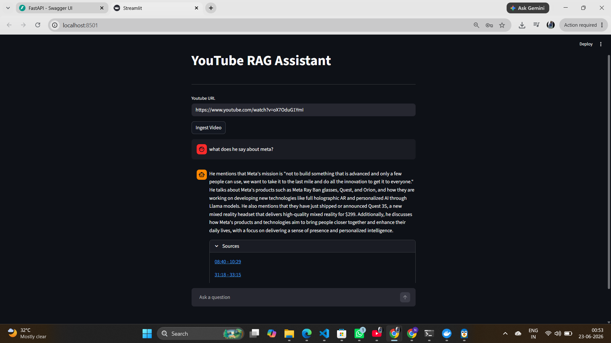
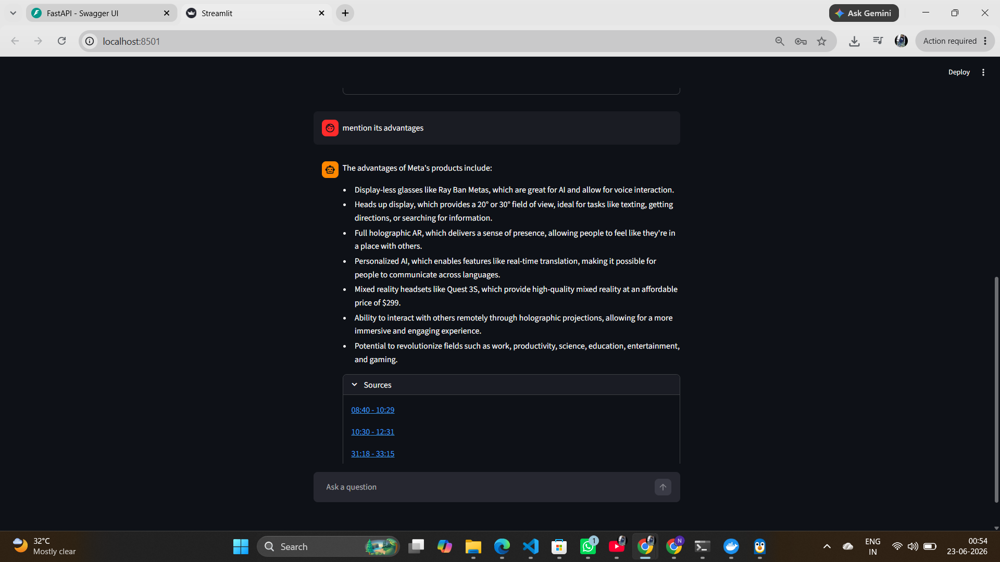
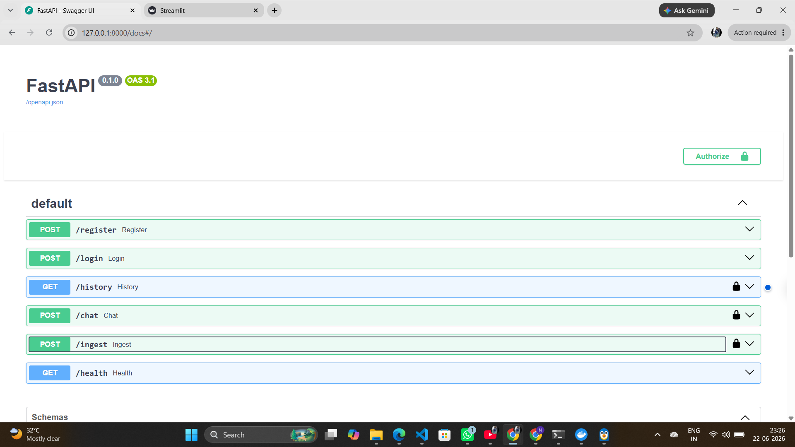

# TubeMind

A Retrieval-Augmented Generation (RAG) system that enables users to chat with YouTube videos using transcript-based semantic search.

The system extracts YouTube transcripts, chunks them into overlapping, timestamped passages, combines FAISS semantic retrieval with BM25 keyword retrieval, fuses the rankings, and reranks the best candidates with FlashRank before generating cited answers with Groq.

The application includes JWT-based user authentication, per-user FAISS indexes, a FastAPI backend, a Streamlit frontend, and SQLite-powered chat history management that allows users to access their previous conversations across sessions.

Live Demo - https://tubemind-frontend.onrender.com
---

# 🏗️ System Architecture



---

# 📸 Demo

## Login Interface

JWT-based authentication with user-specific chat history persistence using SQLite.



---


## YouTube Video QA

Transcript ingestion, conversational question answering, and timestamp-grounded citations.



---

## Multi-turn Conversation & Citation Tracking

User-specific chat history stored in SQLite enables conversation continuity across sessions.



---

## Fastapi Backend

Interactive API documentation generated by FastAPI for authentication, ingestion, chat, and history endpoints.



---
#  Features

## RAG Pipeline

- YouTube transcript ingestion
- Sentence-aware transcript chunks sized by word count, with overlap and timestamps
- Hybrid FAISS semantic and BM25 keyword retrieval
- Reciprocal-rank fusion to combine dense and keyword results
- FlashRank reranking with capped ONNX CPU threading to avoid oversubscription, loaded only for hybrid or rerank searches
- Separate persistent video indexes for each user; reingesting a video replaces its prior chunks
- Timestamp-grounded citations
- Numbered source citations in grounded answers

## User System

- User registration
- User login
- JWT authentication
- Protected endpoints
- User-specific chat history

## Application

- FastAPI backend
- Streamlit frontend
- Dockerized setup
- Optional, explicitly enabled LangSmith tracing
- Retrieval benchmarking framework

## Database Layer

- SQLite database
- User account management
- Persistent chat history storage
- Conversation retrieval by user

---

# ⚙️ Tech Stack

## Retrieval

- LangChain
- FAISS
- Sentence Transformers
- BM25 and reciprocal-rank fusion
- FlashRank CPU reranking

## LLM

- Groq
- Groq `openai/gpt-oss-120b` by default

## Backend

- FastAPI
- Pydantic
- JWT Authentication

## Frontend

- Streamlit

## Database

- SQLite

## Monitoring

- LangSmith

## Deployment

- Docker

---

---

# 🔌 API Endpoints

## Register User

```http
POST /register
```

Request

```json
{
  "username": "nimey",
  "password": "password123"
}
```

---

## Login User

```http
POST /login
```

Request

```json
{
  "username": "nimey",
  "password": "password123"
}
```

---

## Ingest Video

```http
POST /ingest
```

Request

```json
{
  "url": "https://youtube.com/watch?v=..."
}
```

---

## Chat

```http
POST /chat
```

Request

```json
{
  "question": "What are AI concerns?",
  "retrieval_mode": "hybrid"
}
```

`retrieval_mode` is optional and accepts `hybrid` (the default), `similarity`, `mmr`, or `rerank`. Hybrid search combines dense and keyword results before reranking.

The Streamlit app uses `POST /chat/stream` with the same request body. It streams `token` events while the answer is generated and sends the timestamp citations in a final `done` event. The JSON `POST /chat` endpoint remains available for clients that prefer a complete response.

---

## Chat History

```http
GET /history
```

---

## Health Check

```http
GET /health
```

---

# 💬 Example Questions

- What are AI concerns discussed in this video?
- Summarize the video.
- What future does the speaker envision for AI?
- What benefits and risks are discussed?
- What are the key takeaways from the video?
- What does the speaker say about Meta?

---

# 📊 Retrieval Evaluation

The retrieval benchmark compares dense similarity, MMR, reranking, and hybrid retrieval over the currently indexed video. Run `python retrieval_benchmark.py` from the project root. The hybrid path uses cached BM25 statistics for each index, fuses dense and sparse rankings with reciprocal-rank fusion, and reranks up to 20 candidates before sending the top four passages to the answer model. Retrieval quality and latency depend on the video, hardware, and whether the local models are already loaded.

---

# 🧠 Why FastAPI + Streamlit?

FastAPI and Streamlit serve different purposes.

### FastAPI

Responsible for:

- Authentication
- Transcript ingestion
- Retrieval pipeline
- Answer generation
- Chat history management
- REST APIs

### Streamlit

Responsible for:

- User interface
- Video ingestion workflow
- Chat experience
- Citation visualization

This separation creates a cleaner architecture and allows the backend APIs to be reused by other clients such as web applications, mobile apps, or external integrations.

---

# 🔮 Future Improvements

- PostgreSQL migration
- Hybrid Retrieval (BM25 + Dense Retrieval)
- Multi-video knowledge bases
- Streaming responses
- Automated evaluation using RAGAS
- Multi-user vector stores
- Multimodal RAG using video frames and transcripts

---

# 🛠️ Installation

## Clone Repository

```bash
git clone https://github.com/your-username/youtube-rag-system.git
cd youtube-rag-system
```

## Install Dependencies

```bash
pip install -r requirements.txt
```

## Configure Environment Variables

Create a `.env` file:

```env
GROQ_API_KEY=your_key
JWT_SECRET_KEY=generate_a_long_random_value
GROQ_MODEL=openai/gpt-oss-120b

# Optional: enable LangSmith tracing explicitly
ENABLE_LANGSMITH_TRACING=false
LANGCHAIN_API_KEY=your_key
LANGCHAIN_PROJECT=youtube-rag
```

Keep `.env` private; never commit it or share its values.

---

## Run Locally (Windows PowerShell)

From the project root, install backend dependencies if needed:

```powershell
# First-time setup only:
py -3.12 -m venv venv

.\venv\Scripts\python.exe -m pip install -r requirements.txt
```

Open a PowerShell terminal in the project root and start the backend:

```powershell
.\venv\Scripts\python.exe -m uvicorn main:app --reload
```

Open a **second** PowerShell terminal in the project root and start the frontend:

```powershell
.\venv\Scripts\python.exe -m streamlit run frontend\app.py
```

Open `http://localhost:8501`, register or log in, ingest a YouTube video, then ask a question. The backend API and interactive docs are available at `http://127.0.0.1:8000` and `http://127.0.0.1:8000/docs`.

The first ingestion may take longer while the local embedding model is downloaded and initialized. The first hybrid question may also take longer while the reranker loads. You need a valid `GROQ_API_KEY` and a strong, private `JWT_SECRET_KEY` in `.env`. `GROQ_MODEL` is optional; its default, `openai/gpt-oss-120b`, is a current recommended replacement for the retired `llama-3.3-70b-versatile` model. LangSmith tracing is disabled unless you explicitly set `ENABLE_LANGSMITH_TRACING=true`; enabling it sends traces to LangSmith. After updating, ingest videos again so they are stored in your account-specific index.

## Run with Docker Compose

From the project root, with a valid `.env`:

```powershell
docker compose up --build
```

Stop the services with `Ctrl+C`. The backend API and frontend run on ports `8000` and `8501`. Video indexes, model downloads, and the chat database are stored in the mounted `faiss_index`, `model_cache`, and `data` folders.
